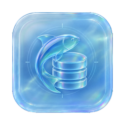
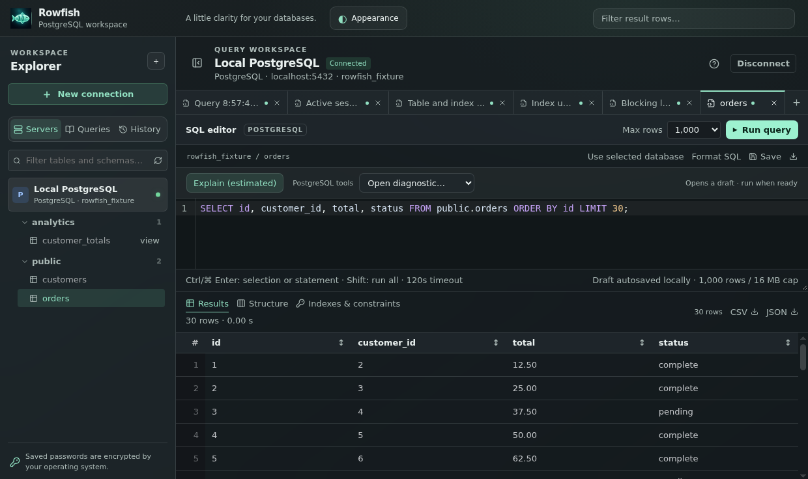
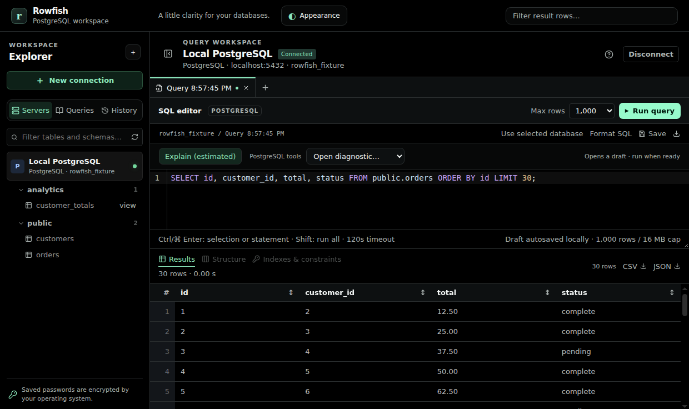
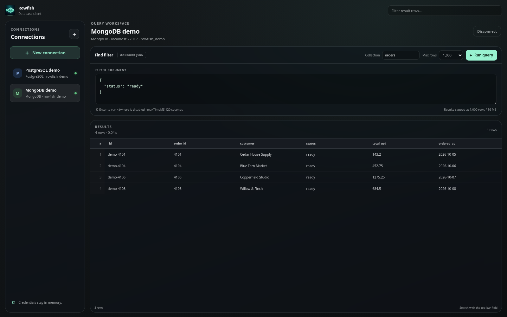

<p align="center"></p>

# Rowfish

**A PostgreSQL-first desktop query client, with MongoDB support available.**

Rowfish brings persistent SQL tabs, a searchable server explorer, schema-aware autocomplete and a virtualized results grid into one compact workspace. It is built with prerelease Electron 46, React and TypeScript; existing MongoDB workflows remain available.

## Install

**Homebrew (macOS, Apple Silicon):**

```bash
brew tap pylotlight/rowfish https://github.com/PylotLight/Rowfish.git
brew install --cask rowfish
xattr -cr /Applications/Rowfish.app
```

Builds are unsigned for now, so macOS may say Rowfish is "damaged". That's the quarantine flag on an unsigned app, not a bad build; the `xattr` line clears it (Homebrew v6 dropped `--no-quarantine`). Or grab the arm64 DMG/ZIP from [Releases](https://github.com/PylotLight/Rowfish/releases).

## See Rowfish







These previews show Rowfish with synthetic local order data, not production databases or customer records. The PostgreSQL workbench is exercised against a disposable PostgreSQL fixture by the desktop smoke test.

## What it does

- Open **Settings** from the always-visible gear at the bottom of the workspace (or **⌘/, Ctrl/,**). Choose Glass, AMOLED black, Deep, Forest, Plum or Paper themes, preset/custom accents, interface font, density, blur and motion. Configure editor font/size, line numbers and wrapping with a live preview. Preferences save locally without closing connections or discarding query drafts. The adjacent power icon quits Rowfish.
- Inspect PostgreSQL estimated execution plans in an expandable **Plan** tab, review raw JSON, and export the plan. Explain uses one selected statement or a single-statement draft, never adds `ANALYZE`, and rejects scripts and unsupported commands.
- Open ready-to-review PostgreSQL diagnostic drafts for active sessions, table/index sizes, index usage, and blocking locks. Diagnostics never run automatically.
- Save PostgreSQL or MongoDB connection profiles between sessions; passwords and MongoDB URI secrets are encrypted with the operating system credential store.
- Quickly connect by pasting a `postgres://`/`postgresql://` or `mongodb://`/`mongodb+srv://` URI: the database type is detected from the scheme, no dropdown needed. Or switch to **Manual** to pick the type and fill in the fields; values carry across both ways.
- **Test & Save** checks the server before saving a profile (with **Save anyway** if the test fails), or **Save without testing** to store a profile for a server that is not reachable yet.
- Browse accessible PostgreSQL databases on a server, inspect schemas and tables in the sidebar, and load a table query with one click.
- Browse accessible MongoDB databases and collections, inspect collection estimates, validators and indexes, and open a collection with one click.
- Keep SQL drafts in persistent in-app tabs; organize named queries in folders and search execution history. External SQL files are optional exports.
- Restore a draft or saved query while offline, then press **Run query** (or the run shortcut) to choose a compatible live/saved connection or add a new one. Server profiles let you choose the target database. Reconnecting keeps the same draft and never executes it automatically; review the database and press Run again.
- Run the current PostgreSQL statement, selected SQL or a multi-statement script. Use autocomplete, formatting, and columns/indexes/constraints inspection. Scripts stop at the first error and display the final result.
- Existing MongoDB tools support `find`, read-only aggregation, document updates, collection/index operations and confirmed destructive actions.
- Stream results into a virtualized grid; filter and sort received rows, inspect individual rows, export filtered CSV/JSON and cancel running queries.
- Switch results between **List**, **JSON** and **Table** views, Compass style. List shows each document as a card with a collapsible, type-coloured tree (`ObjectId('…')`, strings, numbers, `Object (3)` / `Array (4)`), per-document expand all, copy as EJSON or plain JSON, and for MongoDB `find` results edit, clone and delete shortcuts. A single MongoDB document opens as a list until you pick a view; your pick is remembered.
- Resize table columns by dragging header edges (double-click fits, double-click again resets); widths are remembered per MongoDB collection or per query tab. MongoDB headers show the field type and nested values read `{} 3 fields` / `[] 4 items`.
- Give queries and results the whole window: the Explorer opens as a dismissible popover, not a docked column. Drag its edge, the editor/results divider, or the row-details edge to resize; keyboard-focus a divider and use arrow keys, Home or End. Pane sizes and the collapsed sidebar state are remembered locally. Dialogs also have resize handles.
- Keep query work off the UI thread. Results are bounded to 10,000 rows and 16 MB; queries time out after 120 seconds. Rowfish supports up to eight active connections.

MongoDB aggregation is read-only: `$out`, `$merge` and server-side JavaScript operators are blocked. Updates and deletes require non-empty filters; destructive collection/database drops require typing the exact target name. PostgreSQL executes submitted SQL, including writes; it is not automatically read-only or rolled back. Drafts, saved SQL and history are local data and are not encrypted. Avoid sensitive literals.

## Run locally

Requirements: [Bun](https://bun.sh/) 1.x.

```bash
bun install
bun run dev
```

To try the included fictional demo dataset, use a local PostgreSQL or MongoDB instance and follow [Getting started](docs/getting-started.md). The seed files are [PostgreSQL SQL](docs/examples/postgres.sql) and [MongoDB mongosh JavaScript](docs/examples/mongodb.js).

## Check and package

```bash
bun run test
bun run typecheck
bun run build
bun run start
```

With the disposable `rowfish_fixture` PostgreSQL database seeded using `scripts/smoke-fixture.sql`, `bun run test:smoke` exercises the existing workbench plus theme persistence, estimated plans, diagnostic drafts, and minimum-window layout in Electron. Linux CI runs both suites; native macOS vibrancy still needs a Mac check.

For macOS test builds, run `bun run dist:mac`. See [Mac testing](docs/mac-testing.md) and [Releasing](docs/releasing.md) before packaging or publishing.

## Project documentation

- [Getting started](docs/getting-started.md)
- [Database client](docs/database-client.md)
- [UI comparison and implemented improvements](docs/ui-review.md)
- [Architecture](docs/architecture.md)
- [Mac testing](docs/mac-testing.md)
- [Releasing](docs/releasing.md)
- [Troubleshooting](docs/troubleshooting.md)

MIT licensed. See [LICENSE](LICENSE).

## Development

Use Bun 1.4.4 or newer. Install dependencies with `bun install --frozen-lockfile`; run `bun run format` to format files and `bun run format:check` to verify formatting. Run `bun run typecheck`, `bun run test` and `bun run build` for validation.
